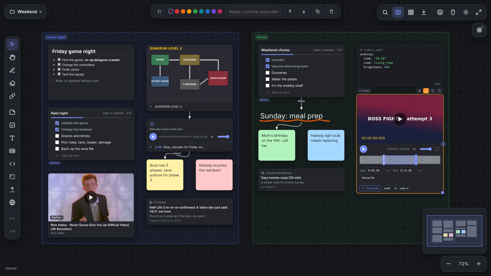

# Easy Board

A local whiteboard for notes, checklists, Markdown, code, images, PDF, audio and video, with connections between cards. Everything stays on your computer, in one folder. No cloud, no account.



- **Cards**: notes, checklists, text, Markdown, code, frames, images, PDF, audio, video, web links and players. Drawing, connections, tags, search, minimap.
- **Audio and video**: play just a selected part of a file; local speech to text (faster-whisper) with a clickable transcript.
- **Text recognition in images** with llama.cpp or Ollama, also fully local.
- **Your data is plain files**: version history, Markdown + files export, project `.zip` import/export.

## Quick start

```
uv run main.py
```

Windows: `start.bat`. Linux/macOS: `./start.sh`. Without uv: `start-pip.bat` / `./start-pip.sh`. The board opens at http://localhost:8765/. See [Running and options](docs/running.md).

## Documentation

- [Using the board](docs/usage.md): controls, checklists, links, search
- [Transcription and text recognition](docs/ai.md)
- [Data, history, export](docs/data.md)
- [Running and options](docs/running.md): install, command line, settings, network

## Disclaimer

Easy Board was written as a strictly **local, single-user tool**. It has no accounts, no passwords and no encryption, and it is **not designed or hardened to be exposed to a network or the internet**. The `--host` option exists only so you can run it on a trusted home or office network at your own risk: anyone who can reach the address can read and change your boards, upload files, and make the server fetch web addresses. Do not put it behind a public address or port forwarding. The software is provided "as is", without warranty of any kind, and the author takes no responsibility for any damage, data loss or security incident resulting from its use, in particular from running it on a network.
