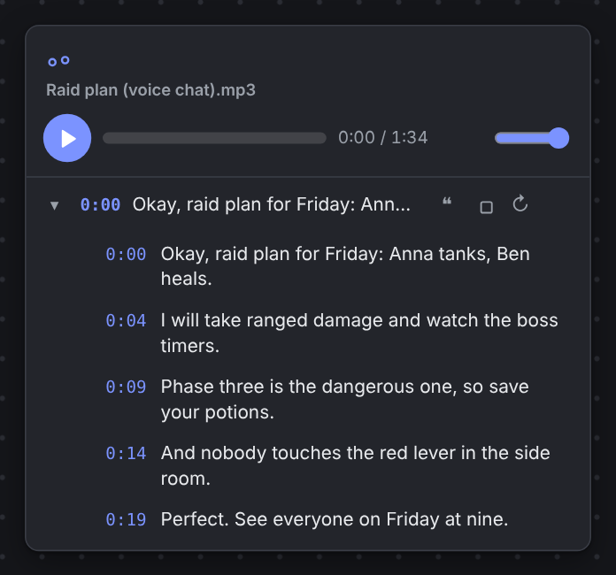
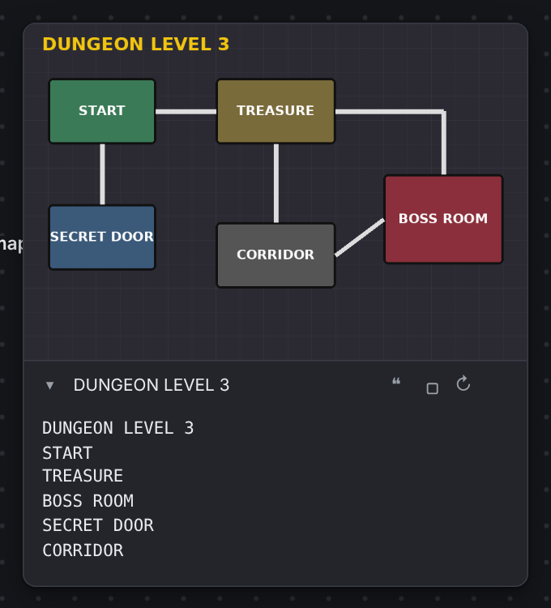

# Transcription and text recognition

Everything runs on your computer; models are downloaded on first use.

## Transcription

Press "Transcribe" under an audio or video card (model and language are chosen next to it). It uses faster-whisper: GPU if CUDA is available, otherwise CPU. Models are stored in `data/models/` (small is about 480 MB, large-v3 about 3 GB). Jobs run in the background, survive a page reload and are saved in the project. Click a phrase to play from there; Ctrl/Shift+click selects phrases to quote into a Markdown note with timecode links.

## Text in images

Press "Recognize text" under an image. The text is shown under the image, can be copied or turned into a note, and is searchable and exported.

Engines (chosen in the Models panel, the chip button at the top right):

- **llama.cpp** (default): enter the path to `llama-server`, a model (a `.gguf` + `mmproj` file, or a Hugging Face repo such as `ggml-org/GLM-OCR-GGUF`) and arguments. The board starts and stops `llama-server` itself. If the toggle is grey, the reason is shown in red. Log: `data/.tmp/llama-server.log`.
- **Ollama**: default `http://127.0.0.1:11434`, change with `--ollama`.

## Memory

Each model in the panel has a toggle (load and keep / unload) and an "Unload now" button. Models loaded by a job unload themselves after the chosen idle time: 10 minutes by default, "never", or "instantly" right after the job.
