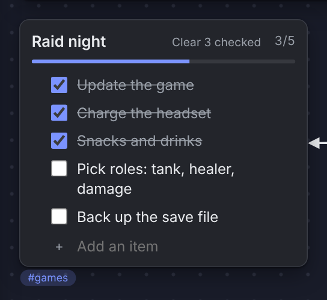
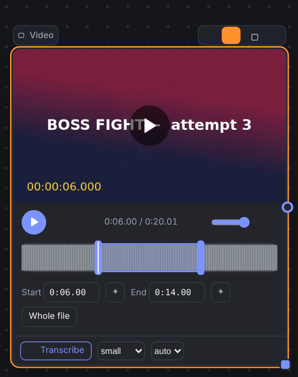

# Using the board

| Action | How |
|---|---|
| Pan / zoom | space + mouse, middle button, Hand tool (H) / wheel (Ctrl+wheel always zooms), `+` `-` `0`, `F` fits everything |
| Add cards | buttons on the left; double-click empty space for free text; drop files; Ctrl+V (text, images, screenshots, URLs) |
| Edit | double-click a card or the pencil above it; Esc to finish |
| Draw | P pen, E eraser; color, size, opacity in the top panel; the layers button puts ink above or below the cards |
| Connect | drag from the circle on a card's right edge (or the L tool); click a connection for color, arrow, dashes, label |
| Select | marquee, Shift+click; Del deletes; Ctrl+D duplicates; Ctrl+C/X/V works between projects and tabs; Ctrl+Z / Ctrl+Shift+Z |
| Align | the top panel with 2+ cards selected; snapping guides while dragging (Alt disables) |
| Projects | the name in the top left: create, rename, copy, delete, `.zip` export/import, version history |
| Search | Ctrl+F: text, titles, file names, checklist items, transcripts, recognized text, `#tags` |

## Checklists

The checkmark button adds a checklist card. Enter adds an item (splitting at the cursor), Backspace at the start joins with the previous one, the handle on the left reorders, and pasting several lines creates several items (`- [x] text` is understood). "Clear checked" removes the done ones. In Markdown export they become `- [x]`.

## Frames, tags, search

A **frame** is a named area: drag its title and the cards inside follow. **Tags** and a color accent are set in the panel above a selected card; clicking a tag dims everything else.

## Audio and video

Pick just a part of a file to play: in edit mode (pencil) drag the handles on the waveform or type start/end times; "play" then covers only that range, and the original file is untouched. Transcription: see [ai.md](ai.md).

## Links

Paste or drop an address (or Ctrl+K). Files (image, audio, video, PDF, text) are downloaded into a normal card; other pages become a bookmark (title, description, image) with a saved offline copy; YouTube, Vimeo, Twitch, Spotify and similar become a player card (the cover is saved, the player needs internet). The copy never refreshes by itself: the refresh button downloads it again, and Ctrl+Z brings the old one back. Page copies are single HTML files without scripts, opened under a strict security policy. A card link (`#` button) jumps to a card, also in another project; it contains the server port, so links stop working if you change `--port`.
